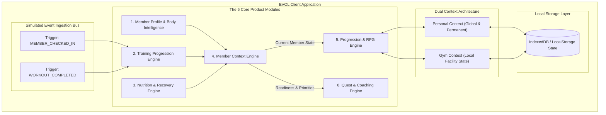
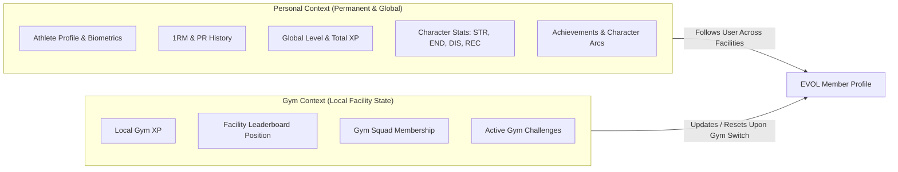
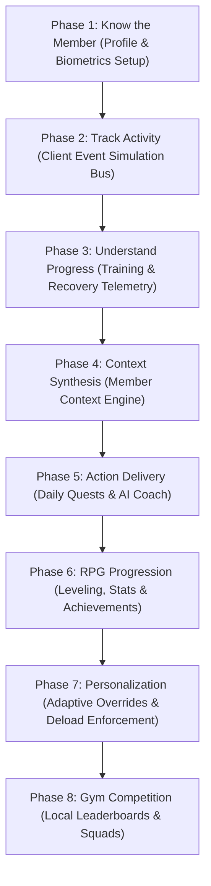

# EVOL: Standalone Gamified Fitness Progression Intelligence System

> **Document Name**: EVOL.md  
> **System Architecture Specification & Technical Blueprint**

---

## Executive Summary

**EVOL** (SoloLvlUp) is a user-centric, gamified fitness progression intelligence platform. It operates on a single core intelligence mission: 
> *"Given everything happening with this gym member, how should this person progress?"*

### Atom OS Decoupling Strategy
Unlike operational gym CRM systems (such as Atom OS, which manage memberships, QR gates, and facility billing), **EVOL operates 100% independently from any live gym backend**. 
- All event triggers (`MEMBER_CHECKED_IN`, `WORKOUT_COMPLETED`) are ingested through a **Client-Side Event Bus** with local simulation triggers.
- **Data Persistence**: All state (profile, workout logs, PR history, RPG levels, quests) is stored in browser storage (**Zustand + LocalStorage / IndexedDB**), ensuring complete offline capability and persistent user progress across browser sessions.

---

## 1. High-Level System Architecture




---

## 2. Implementation Taxonomy Matrix

EVOL uses a disciplined computational taxonomy to optimize performance, eliminate LLM hallucinations for stats, and maximize intelligence:

| Core Engine | Primary Function | Implementation Strategy | Key Technologies / Algorithms |
| :--- | :--- | :--- | :--- |
| **1. Profile & Body Intelligence** | Identity, biometrics, injuries, availability | **Database & Event Records** | Profile schemas, injury filter rules, TDEE/BMR formulas |
| **2. Training Progression Engine** | Log ingestion, PR detection, volume trends | **Algorithms + Rules Engine** | 1RM Epley/Brzycki formulas, ACWR fatigue ratio, plateau checks |
| **3. Nutrition & Recovery Engine** | Recovery score, sleep/protein adherence | **Algorithms + Rules Engine** | Weighted recovery score (0–100), strain-recovery override balance |
| **4. Member Context Engine** | Central brain state synthesis | **Structured Computation + LLM Reasoning** | State snapshot aggregator + Zod schema validation |
| **5. Progression & RPG Engine** | XP calculation, level-ups, stat allocation | **Deterministic Code** | Pure mathematical rules (`Level = floor(0.1 * sqrt(XP))`) |
| **6. Quest & Coaching Engine** | Daily quests, recovery protocols, AI Coach | **Structured Templates + LLM Generation** | Rule-filtered template matching + guarded LLM completions |

---

## 3. Dual Context Architecture

EVOL cleanly separates permanent player attributes from local facility participation:



---

## 4. In-Detail Breakdown of the 6 Core Product Modules

### Module 1: Member Profile & Body Intelligence Engine
- **Purpose**: Tracks athlete baseline, physical limitations, and preferences.
- **Key Features**:
  - **Biometrics Baseline**: Body weight, body fat %, muscle mass, BMR/TDEE calculations.
  - **Availability Vector**: Days available/week, available equipment (barbell, dumbbell, machines, bodyweight), time budget.
  - **Injury & Constraint Filter**: Flags active limitations (e.g. `"LEFT_SHOULDER_IMPINGEMENT"`, `"LOWER_BACK_DISC_HERNIATION"`). Exercises matching constraints are automatically excluded from generated quests.
  - **Nutrition Baseline**: Caloric targets, macronutrient split ($g/kg$ protein target), dietary restrictions.

### Module 2: Training Progression Engine
- **Purpose**: Processes raw set/rep/weight/RPE/duration logs into performance metrics.
- **Key Features**:
  - **Volume & Intensity Analysis**: Computes Weekly Tonnage ($Sets \times Reps \times Weight$) and Set Volume per muscle group.
  - **PR Engine**: Automatically detects 1RM, 3RM, 5RM, max volume, and max rep PRs per exercise.
  - **Plateau Detection**: Identifies performance stalls (3+ sessions without volume/load increase) and signals the Context Engine to recommend variation.
  - **Fatigue Calculation**: Tracks Acute-to-Chronic Workload Ratio (ACWR) to monitor overtraining risk.

### Module 3: Nutrition & Recovery Engine
- **Purpose**: Evaluates the holistic loop of **Training + Nutrition + Recovery**.
- **Key Features**:
  - **Recovery Score (0–100%)**: Weighted calculation:
    $$\text{Recovery Score} = 0.4 \times \text{Sleep} + 0.3 \times \text{HRV/RHR} + 0.3 \times \text{Subjective Readiness}$$
  - **Protein Adherence**: Compares daily protein intake against target.
  - **Adaptive Deload & Recovery Override**: If training strain is elevated while sleep or protein is low, emits a `RECOVERY_PRIORITY` override state.

### Module 4: Member Context Engine (Central Brain)
- **Purpose**: Synthesizes all data sources into a single **Current Member State** JSON object.
- **Key Features**:
  - Aggregates readiness, fatigue, progress trends, active injuries, and RPG levels.
  - Identifies immediate priorities (`DELOAD_REQUIRED`, `PROTEIN_FOCUS`, `HYPERSTROPHY`, `CONSISTENCY_STREAK`).

### Module 5: Progression & RPG Engine (Deterministic Math)
- **Purpose**: Gamifies fitness achievements through predictable, non-hallucinatory rules.
- **Key Features**:
  - **XP Formula**: $\text{XP} = \text{Base XP} + \text{Volume Bonus} + \text{PR Bonus} \times \text{Streak Multiplier}$.
  - **Stat Allocation**:
    - **Strength (STR)**: Heavy compound lifts, progressive overload, volume PRs.
    - **Endurance (END)**: High rep sets, cardio duration, conditioning.
    - **Discipline (DIS)**: Workout consistency, streak maintenance, protein compliance.
    - **Recovery (REC)**: Sleep target adherence, mobility session completions.
  - **Level Equation**: $\text{Level} = \lfloor 0.1 \times \sqrt{\text{Total XP}} \rfloor$.

### Module 6: Quest & Coaching Engine
- **Purpose**: Delivers daily main quests, side quests, recovery protocols, and natural language AI coaching.
- **Key Features**:
  - **Main Quests**: Daily primary workout or enforced recovery protocol.
  - **Side Quests**: Daily micro-habits (protein target, hydration, 10-min mobility).
  - **AI Coach Dialogue**: Natural language explanations grounded strictly in the member's current readiness state.

---

## 5. Event Data Models & Data Contracts

### Event Payload Interfaces (Decoupled Client Bus)

```typescript
export type EVOLEvent = 
  | {
      type: 'MEMBER_CHECKED_IN';
      timestamp: string;
      gymId: string;
      memberId: string;
    }
  | {
      type: 'WORKOUT_COMPLETED';
      timestamp: string;
      gymId: string;
      memberId: string;
      workout: {
        id: string;
        name: string;
        durationMinutes: number;
        exercises: Array<{
          exerciseId: string;
          exerciseName: string;
          sets: Array<{ weightKg: number; reps: number; rpe?: number }>;
        }>;
      };
    };
```

### State Schema (`CurrentMemberState`)

```typescript
export interface CurrentMemberState {
  memberId: string;
  timestamp: string;
  profileSummary: {
    fitnessGoal: 'FAT_LOSS' | 'MUSCLE_GAIN' | 'STRENGTH' | 'ENDURANCE';
    experienceLevel: 'BEGINNER' | 'INTERMEDIATE' | 'ADVANCED';
    activeLimitations: string[];
  };
  readiness: {
    score: number; // 0 - 100
    status: 'OPTIMAL' | 'MODERATE' | 'FATIGUED' | 'CRITICAL_RECOVERY';
    fatigueIndex: number;
  };
  nutritionRecovery: {
    proteinAdherencePct: number;
    sleepHoursLastNight: number;
    recoveryDeficit: boolean;
  };
  trainingProgress: {
    volumeTrend: 'UP' | 'STABLE' | 'DOWN';
    plateauDetected: boolean;
    recentPRs: string[];
  };
  rpgState: {
    level: number;
    xp: number;
    nextLevelXp: number;
    stats: { strength: number; endurance: number; discipline: number; recovery: number };
  };
  immediatePriorities: Array<'DELOAD_REQUIRED' | 'PROTEIN_FOCUS' | 'HYPERSTROPHY' | 'CONSISTENCY_STREAK'>;
}
```

---

## 6. The 8-Phase Member-Journey Build Roadmap



---

## 7. Client Codebase Structure (`EVOL`)

```
EVOL/
├── EVOL.md                                 # Master System Specification (This Document)
├── src/
│   ├── types/
│   │   ├── events.ts                       # EVOLEvent interfaces
│   │   ├── member-state.ts                 # CurrentMemberState interface
│   │   └── rpg.ts                          # Character stats & quest interfaces
│   ├── lib/
│   │   ├── engines/
│   │   │   ├── body-intelligence.ts        # Module 1: Profile & Biometrics
│   │   │   ├── training-engine.ts          # Module 2: Volume, PRs & ACWR
│   │   │   ├── recovery-engine.ts          # Module 3: Recovery score & Deficit override
│   │   │   ├── context-engine.ts           # Module 4: Central Brain Synthesizer
│   │   │   ├── rpg-engine.ts               # Module 5: Deterministic XP & Stats Math
│   │   │   └── quest-engine.ts             # Module 6: Template Filter & LLM Coach
│   │   └── storage/
│   │       └── persistent-store.ts         # Client Browser Storage (Zustand + LocalStorage)
│   └── components/
│       ├── event-simulator.tsx             # Simulated Check-in / Workout buttons
│       ├── quest-card.tsx                  # Main & Side Quest Display UI
│       ├── rpg-status-bar.tsx              # Level, XP, STR/END/DIS/REC Bar
│       └── ai-coach-chat.tsx               # Context-aware AI Coach dialogue
└── package.json
```

---

## Verification Plan

### Automated Verification
- **RPG Math Verification**: Unit tests for deterministic XP, level-ups, and stat distribution (`rpg-engine.test.ts`).
- **Recovery & Deload Logic**: Unit tests verifying recovery overrides when sleep/protein is low (`recovery-engine.test.ts`).
- **Persistence Verification**: Unit tests for local browser storage hydration and state consistency across events.

### Manual Verification
- Walk through Phases 1–8 in browser environment:
  1. Complete Onboarding Profile setup.
  2. Click "Simulate Gym Check-In" -> Verify streak & Discipline XP increase.
  3. Click "Simulate Workout Completed" -> Verify volume computation, PR detection, and Level-up notification.
  4. View Daily Quests & AI Coach response tailored to current state.
